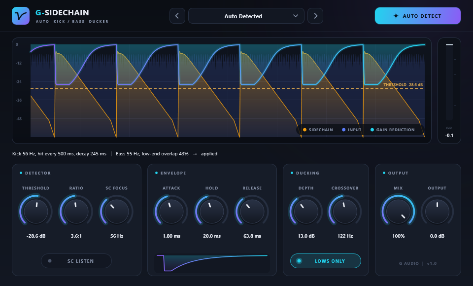

# G-SideChain

**Auto-detecting kick / bass sidechain ducker — VST3 for Windows.**

Put it on your bass, feed it your kick, press **AUTO DETECT**. It listens to both, works out the kick's pitch, rhythm and decay and how much they fight in the low end, then sets every control for you.



## Features

- **Auto Detect** — 4 seconds of listening sets threshold, ratio, depth, attack, hold, release, sidechain focus, crossover and lows-only mode
- **Lows Only** — ducks just the sub below an adjustable crossover (Linkwitz-Riley), so the bass's upper harmonics keep playing
- **SC Focus** — the detector hears the kick through a band-pass at its fundamental, so hats and snares don't trigger ducking
- **10 factory presets** — Init, EDM Pump, Techno Tight, House Groove, Hip-Hop 808, Subtle Glue, Sub Only Duck, Future Bass Swell, Drum & Bass Snap, Parallel Pump
- **Live display** — scrolling kick / input / gain-reduction scope with threshold line, GR meter, envelope shape preview, "no sidechain signal" warning
- **SC Listen** to hear exactly what triggers the ducking, plus Mix and Output

## Install

1. Download `G-SideChain-v1.0.0-win64.zip` from [Releases](https://github.com/DakaGoa/G-Sidechain/releases/latest) and unzip it.
2. Copy the **`G-SideChain.vst3`** folder to `C:\Program Files\Common Files\VST3\` (needs admin).
3. Rescan plugins in your DAW.

The zip also contains a standalone `G-SideChain.exe` for trying the UI without a DAW.

## Use it in FL Studio

1. Send the kick and the bass to their own mixer tracks (e.g. Insert 1 = kick, Insert 2 = bass).
2. Load **G-SideChain** on the **bass** track.
3. Select the **kick** track, right-click the routing arrow at the bottom of the **bass** track → **Sidechain to this track**. The kick still goes to the master as usual.
4. In G-SideChain's wrapper click the **gear icon → Processing** tab and set the **Sidechain** input to the kick's mixer track.
5. Press play — the orange **SIDECHAIN** trace should move and the red *NO SIDECHAIN SIGNAL* badge disappears.
6. Click **AUTO DETECT** while kick and bass play together. Tweak **Depth** and **Release** to taste.

Other DAWs: route the kick to the plugin's sidechain input the way your DAW does it (Ableton: *Audio From* in the plugin's sidechain section; Cubase: activate side-chain and add a send; Reaper: send the kick to channels 3/4).

## How Auto Detect decides

| It measures | It sets |
| --- | --- |
| Kick fundamental (spectral peak, 30–200 Hz) | **SC Focus** |
| Kick level the detector sees, decay to −24 dB, hit interval | **Threshold** and **Release** so the bass is back before the next kick |
| Kick rise time and body length | **Attack** and **Hold** |
| Spectral overlap of kick and bass below 300 Hz, bass-vs-kick low-end level | **Depth** and **Ratio** |
| Bass energy above the crossover | **Lows Only** on/off and **Crossover** |

Capture starts when the kick reaches the sidechain, so a bass-only intro won't fool it. If no kick is found it tells you instead of changing anything. After a detect the preset list shows **Auto Detected**.

## Build from source

Requirements: Windows, Visual Studio 2022 or 2026 (C++ desktop workload), CMake 3.22+, and a [JUCE 9](https://github.com/juce-framework/JUCE) checkout.

```powershell
git clone https://github.com/juce-framework/JUCE.git $env:USERPROFILE\JUCE
cmake -S . -B build -G "Visual Studio 18 2026" -A x64
cmake --build build --config Release
```

JUCE is looked for in `%USERPROFILE%\JUCE`; pass `-DJUCE_DIR=<path>` to use another location. Use `-G "Visual Studio 17 2022"` for VS 2022.

Output: `build\GSideChain_artefacts\Release\VST3\G-SideChain.vst3` and `...\Standalone\G-SideChain.exe`.

### Self-test

```powershell
cmake --build build --config Release --target GSideChainTests
build\GSideChainTests_artefacts\Release\GSideChainTests.exe
```

Runs the analyzer and the full plugin on a synthetic kick + bass loop (detection, ducking depth and recovery, presets, state save/restore, cancel flow) and renders the UI to `gsidechain_ui.png`.

## Project layout

| Path | What |
| --- | --- |
| `Source/SidechainCore.*` | DSP: detector, ducker engine, Auto Detect analyzer |
| `Source/PluginProcessor.*` | Parameters, presets, buses, capture, state |
| `Source/PluginEditor.*` | UI and look-and-feel |
| `Tests/TestMain.cpp` | Self-test |
